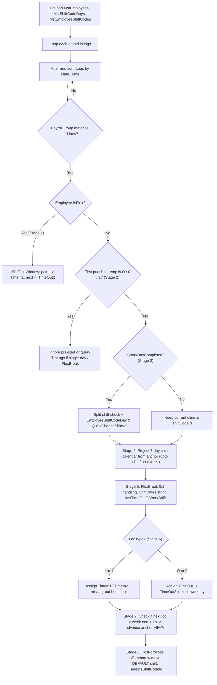

# `DTR.ProcessDtrLines` — Technical Reference, Bottleneck Analysis & Safe Optimization Guide

* **Source File:** `whris.Application/Library/DTR.cs` (Lines `2714–4028`)
* **Related Entry Point:** `whris.Application/CQRS/TrnDtr/Commands/AddDtrLinesByProcessDtr.cs`
* **Related Queries & DTOs:** `whris.Application/Queries/TrnDtr/EmployeeShiftCodeDay.cs`, `whris.Application/Dtos/TrnDtrLineDto.cs`, `whris.Application/Dtos/TmpDtrLogs.cs`
* **Production Context:** Shared codebase serving 3 live company instances on separate SQL Server databases. Zero-drift parity is mandatory on any change.

---

## 1. Overview & Execution Context

`DTR.ProcessDtrLines` is the core biometric log-pairing engine for WHRIS. It takes raw chronological biometric swipes (`TmpDtrLogs`) and maps each swipe onto pre-seeded daily DTR rows (`TrnDtrLineDto`), resolving dynamic shifts, overnight shifts, mid-shift breaks, flextime windows, and missing punches.

### How It Fits in the DTR Pipeline

1. **Command Entry (`AddDtrLinesByProcessDtr.AddDtrLinesHandler.Handle`, `AddDtrLinesByProcessDtr.cs` lines 27–40)**
   * Receives `DTRId`, `PayrollGroupId`, optional `DepartmentId` / `EmployeeId`, `DateStart`, `DateEnd`, optional `ChangeShiftId`, and `List<TmpDtrLogs>? TmpDtrLogs`.
   * Initializes an empty `List<TrnDtrLineDto> dtrLines`.
2. **Pre-Seeding (`DTR.ProcessDtrLog`, `DTR.cs` lines 2609–2712)**
   * Resolves target employees via `GetEmployees`.
   * Deletes existing `TrnDtrlines` for those employees inside `[DateStart, DateEnd]` via `ExecuteDelete()`.
   * Uses `DtrBatchProcessor` (`DTR.cs` lines 15–102) to seed **one blank `TrnDtrLineDto` per `(EmployeeId, Date)`** across `[DateStart, DateEnd]` with initial `ShiftCodeId` and `DayTypeId`.
3. **Log-to-Line Pairing (`DTR.ProcessDtrLines`, `DTR.cs` lines 2714–4028)**
   * Signature: `internal static void ProcessDtrLines(int changeShiftId, List<TmpDtrLogs> logs, List<TrnDtrLineDto> dtrLines, DateTime dateStart, DateTime dateEnd, HRISContext _context)`
   * Populates `TimeIn1`, `TimeOut1`, `TimeIn2`, `TimeOut2`, `ShiftCodeId`, `ShiftDates`, and tracking flags on each `TrnDtrLineDto`.
4. **Downstream Hour & Pay Calculation (`DTR.ComputeDtrLines`, `DTR.cs` lines 4029–4332)**
   * Runs later when the user triggers Compute DTR (`EditDtrLinesByComputeDtr`), reading the timestamps and `ShiftDates` populated by `ProcessDtrLines` to compute `RegularHours`, `NightHours`, `OvertimeHours`, `TardyLateHours`, `TardyUndertimeHours`, `Absent`, and peso amounts.

### Biometric Log Types (`TmpDtrLogs`)

| `LogType` | Meaning | Target `TrnDtrLineDto` Field |
| :--- | :--- | :--- |
| `"I"` | Shift Time In (Start of workday) | `TimeIn1` |
| `"0"` | Break Out / Mid-shift Out | `TimeOut1` |
| `"1"` | Break In / Mid-shift In | `TimeIn2` |
| `"O"` | Shift Time Out (End of workday) | `TimeOut2` |

---

## 2. Inputs, Preloaded Data & Per-Employee State Machine

### Upfront Table Preloads (Lines 2716–2720)

Before looping over logs, `ProcessDtrLines` materializes three entire master tables into arrays and groups the input logs by employee:

* `employeesInLog = logs.GroupBy(x => x.EmployeeId).Select(y => y.Key)`
* `employees = _context.MstEmployees.ToArray()`
* `shiftCodeDays = _context.MstShiftCodeDays.ToArray()`
* `employeeShiftCodes = _context.MstEmployeeShiftCodes?.ToArray() ?? new MstEmployeeShiftCode[0]`
* `toBeProcessedPayrollGroupId` (Line 2752): Taken from the first employee in `dtrLines` (`dtrLines.FirstOrDefault()?.EmployeeId`) to skip logs belonging to employees outside the active DTR's payroll group.

### Per-Employee State Variables (Lines 2726–2753)

| Variable | Type | Purpose |
| :--- | :--- | :--- |
| `isFlex` | `bool` | Employee works pure flextime (`MstEmployee.IsFlex`); takes the simplified 19h pairing branch. |
| `isFlexBreak` | `bool` | Employee can take break punches dynamically (`MstEmployee.IsFlexBreak`), even on 2-swipe shifts. |
| `isLongShift` | `bool` | Employee works extended shifts (`MstEmployee.IsLongShift`, e.g., 12–24h shifts), enabling gap-based out promotion (`12h–36h`). |
| `isWorkDayCompleted` | `bool` | Tracks whether the previous workday has finished so the next punch should start a new `dline` and resolve a new shift. Starts `true`. |
| `isWorkDayCompletedFlex` | `bool` | Same workday-completion latch specifically for `isFlex` employees. Starts `true`. |
| `dline` | `TrnDtrLineDto` | Current day's DTR line being populated across multiple punches. |
| `dlineIsJumped` | `bool` | Set to `true` when a second workday starts on the same calendar date (`dline` already has `TimeIn1` & `TimeOut2`), jumping to `log.Date.AddDays(1)`. |
| `shiftCodeId` | `int` | Active `ShiftCodeId` resolved for the current workday. |
| `firstDateOfLogWeeklyPerEmployee` | `DateOnly` | Rolling 7-day anchor date used to assign concrete calendar dates to `MstShiftCodeDay` entries. |
| `aWeekIsLapsed` | `bool` | Flag set when the weekly anchor advances by `+6` or `+7` days at the end of a week. |
| `lastTimeOutOfWorkShift` | `DateTime` | Latest `"O"` or `"0"` punch found in the current shift window (`[TimeIn1, TimeOut2 + 8h]`), used to detect when the final out of a shift arrives. |

### `TrnDtrLineDto` Working Flags & Backup Fields (`TrnDtrLineDto.cs` lines 188–214)

| Field | Purpose |
| :--- | :--- |
| `IsSplitted` | Marks lines involved when two shifts start on the same calendar day (`dlineIsJumped`). |
| `IsShiftCodeIsTommorow` | Marks lines whose `MstShiftCodeDay.IsTommorow == true` (e.g., graveyard shifts logged under yesterday's punch-in date that belong to the next calendar DTR date). |
| `IsDateMoved` | Set to `true` on `empDLineTommorow` after Stage 8 relocates an `IsTommorow` line's timestamps forward by 1 day. |
| `OldShiftCodeId`, `OldTimeIn1`, `OldTimeOut1`, `OldTimeIn2`, `OldTimeOut2`, `OldShiftDates` | Backup copies stored during Stage 8 relocation so original values are preserved during row shifting. |
| `NoTimeIn1`, `NoTimeOut2` | Missing-punch markers set by heuristics when an employee starts on `"0"`/`"O"` or ends without an `"O"` punch. |
| `Is2SwipesOnly` | True when the shift has `TimeOut1 == null && TimeIn2 == null` (no scheduled lunch break swipes). |
| `TimeIn1ShiftCodeId` | Captures the `ShiftCodeId` resolved at the moment the `"I"` punch was processed so Stage 8 can restore it if later punches altered `ShiftCodeId`. |

---

## 3. End-to-End Flow & Stage-by-Stage Walkthrough

### High-Level Pipeline

### Stage 0 — Payroll Group Guard & Mode Detection (Lines 2754–2777)

* Iterates `fLogs = logs.Where(x => x.EmployeeId == empId).OrderBy(x => x.Date).ThenBy(x => x.Time)`.
* Compares each log's employee `PayrollGroupId` against `toBeProcessedPayrollGroupId`; skips mismatched employees.
* Contains leftover empty debug `if` blocks (`04/13/2025 12:02:00 PM` at line 2765, `2025-06-10` at line 2780).
* Reads `isFlex`, `isFlexBreak`, and `isLongShift` from `employees`.

### Stage 1 — Pure Flextime Fast Path (`isFlex == true`, Lines 2778–2881)

When `isFlex` is `true`, the employee bypasses standard shift-day matching completely:

1. Matches `dline` on `(EmployeeId, log.Date)`. If both `TimeIn1` and `TimeOut2` are already populated, skips the log.
2. Assigns `dline.ShiftCodeId` from `employeeShiftCodes`.
3. On an `"I"` punch (`dline.TimeIn1 == null`):
   * Checks the interval to `nextLog`: if `intervalInHours > 19` and on a different calendar date, records `TimeIn1 = logDateTime`, sets `isWorkDayCompletedFlex = true`, and leaves `TimeOut2` null.
   * Otherwise sets `dline.TimeIn1 = logDateTime` and scans up to `logDateTime.AddHours(19)` to record the latest log timestamp in `shiftTimeOut2Flex`.
4. On subsequent punches (`dline.TimeIn1 != null && dline.TimeOut2 == null`, or if `TimeIn1 == null && shiftTimeOut2Flex == DefaultDate`), assigns `dline.TimeOut2 = logDateTime` and closes the workday (`isWorkDayCompletedFlex = true`).

### Stage 2 — Orphan First-Swipe Recovery (Lines 2884–3008)

If the very first log seen for a standard employee (`currentProcessedEmployeeId != log.EmployeeId`) is `"O"`, `"0"`, or `"1"` (typically an overnight out-punch from the previous day's shift):

* **Before `dateStart` (Lines 2888–2891):** Ignored (`continue`).
* **Single-day run (`dateStart == dateEnd`, Lines 2894–2955):** Queries `_context.TrnLogs` directly by `BiometricIdNumber` for yesterday's last `"I"` (`[startPrev, endPrev]`) and today's `"O"` (and `"1"` if `isFlexBreak`). Resolves `ShiftCodeId` via `EmployeeShiftCodeDay` + `QuickChangeShiftv3`.
* **Multi-day `isFlexBreak` run (Lines 2958–3001):** Queries `_context.TrnLogs` for today's `"O"` and `"1"`, resolving `ShiftCodeId` via `QuickChangeShiftv3`.
* **Note:** If `employees.FirstOrDefault(a => a.Id == empId)` returns `null` at line 2902 or 2966, it executes `return;` (see Section 5).

### Stage 3 — New Workday Initialization & Dynamic Shift Lookup (Lines 3025–3136)

Executes only when `dline is not null && isWorkDayCompleted`:

1. **Missing-out / half-day guards (Lines 3027–3060):**
   * If `!isLongShift && dline.NoTimeOut2 && dline.Is2SwipesOnly` and the punch is `"0"` or `"1"`, skips it.
   * If `"O"` or `"0"` arrives while `dline.NoTimeOut2 && !dline.Is2SwipesOnly`, assigns `TimeOut1` and sets `HalfdayAbsent = true`.
   * For 2-swipe shifts with parsed `ShiftDates`, if a `"0"` or `"1"` arrives after `lastTimeOutOfWorkShift`, ignores it and keeps `isWorkDayCompleted = true`.
2. **Line lookup & split-shift rollover (Lines 3062–3071):**
   * Finds `dline` matching `(log.EmployeeId, log.Date)`.
   * If that `dline` already has both `TimeIn1` and `TimeOut2` from an earlier completed workday, marks `dline.IsSplitted = true`, advances `dline` to `log.Date.AddDays(1)` (also marked `IsSplitted = true`), and sets `dlineIsJumped = true`.
3. **Long-shift duplicate `"O"` & early `"O"` exit (Lines 3073–3110):**
   * `isLongShift` skips `"O"` punches already recorded as `TimeOut2` on an earlier line.
   * If `log.LogType == "O"` (`isFlexBreak` or standard), assigns `dline.TimeOut2 = logDateTime`, sets `isWorkDayCompleted = true`, and skips shift lookup (`continue`).
4. **Dynamic shift resolution (Lines 3112–3135):**
   * Queries `EmployeeShiftCodeDay.Result(isLongShift ? log.LogType : null)` (Dapper SQL query against `MstShiftCodeDay` + `MstEmployeeShiftCode`) to rank the employee's assigned shifts by proximity to `logDateTime` (±20h wrap handling).
   * Calls `QuickChangeShiftv2(_context, ..., changeShiftId: 0, dline.ShiftCodeId)` to pick the closest shift.
   * Stores `dline.TimeIn1ShiftCodeId = dline.ShiftCodeId` when `log.LogType == "I"`.
   * Falls back to `MstEmployee.ShiftCodeId` if `shiftCodeId == 0`, then opens the workday (`isWorkDayCompleted = false`).

### Stage 4 — Rolling 7-Day Shift Calendar Projection (Lines 3144–3290)

Determines which `MstShiftCodeDay` record applies to the current `logDateTime`:

1. Anchors `firstDateOfLogWeeklyPerEmployee` to the employee's earliest log date (first time only).
2. Builds `dictNumericDays` rotating the 7 weekday names starting from `firstDateOfLogWeeklyPerEmployee.ToString("dddd")` and sorts `shiftCodeDays` for `shiftCodeId`.
3. **Mutates each `MstShiftCodeDay` in `orderedShiftCodeDays`** (Lines 3180–3230) by stamping `dateOfLogWeeklyPerEmployee` onto `TimeIn1`, `TimeOut1`, `TimeIn2`, `TimeOut2`—adding `+1 day` whenever `TimeOnly(TimeOut1/TimeIn2/TimeOut2) < TimeOnly(TimeIn1)` (overnight shift).
4. **Window match (Lines 3235–3254):** Picks the shift day where `logDateTime` falls inside `[shiftCode.TimeIn1 - 4h, shiftCode.TimeOut2 + 7h]`.
5. **Fallback & weekly jump (Lines 3255–3289):**
   * If `logDateTime <= lastShiftCodeTimeOut`, matches by `orderedShiftCodeDaysFilterForLastLogTime.ToString("dddd")` (using `dline.TimeIn1` if the punch is `"O"`), or `logDateTime.AddDays(1)` weekday.
   * Otherwise, advances `firstDateOfLogWeeklyPerEmployee` by `+7` days and jumps back via `goto restartTheOrderedShiftCodeDays;` (line 3281).

### Stage 5 — FlexBreak Mid-Shift Recording, `ShiftDates`, and Lookahead Out (Lines 3291–3385)

* **FlexBreak `"0"` / `"1"` on 2-swipe shifts (Lines 3291–3322):** If `shiftCodeDay` has no scheduled break (`TimeOut1 == null && TimeIn2 == null`) and `!isLongShift`, an `isFlexBreak` employee records `"0"` into `TimeOut1` and `"1"` into `TimeIn2`, and closes `isWorkDayCompleted = true` if the last non-`"I"` punch in `[TimeIn1 - 4h, TimeOut2 + 8h]` is not `"O"`.
* **`ShiftDates` serialization (Lines 3326–3349):** Sets `dline.IsShiftCodeIsTommorow = shiftCodeDay.IsTommorow`. On the `"I"` punch (when `ShiftDates` is still null), writes comma-separated `TimeIn1,TimeOut1,TimeIn2,TimeOut2`—shifting all four timestamps back by `-1 day` if `isLongShift && logDateTime.Date == prevDLine.TimeOut2.Date && shiftCodeDay.IsTommorow`.
* **`lastTimeOutOfWorkShift` lookahead (Lines 3351–3385):** Scans `fLogs` in `[shiftCodeDay.TimeIn1, shiftCodeDay.TimeOut2 + 8h]` for the latest `"O"` (or `"O"`/`"0"` on 4-swipe shifts) so Stage 6 knows when the final out punch of the shift arrives.

### Stage 6 — Punch Placement & Missing-Out Heuristics (Lines 3387–3802)

#### In Punches (`"I"` or `"1"`, Lines 3387–3673)

* **4-swipe shifts (`TimeOut1 != null`, Lines 3389–3455):**
  * Before `TimeOut2`: fills `TimeIn1` (or `TimeIn2` if `dline.NoTimeIn1`), keeps earliest `"I"` if within 12h of `nextLog`, or assigns `TimeIn2` if within 2h of `shiftCodeDay.TimeOut1`.
  * Between `TimeOut1` and `TimeOut2`: assigns earliest punch to `TimeIn2`.
* **2-swipe shifts (`TimeOut1 == dline.Date` or null, Lines 3457–3477):** Assigns earliest punch before `TimeOut2` to `TimeIn1` (explicitly skipping `log.LogType == "1"` per the `04/13/2026` comment at line 3463).
* **No out-punch found in shift window (`!workDayHasOut && !isFlexBreak`, Lines 3500–3644):**
  * **`isLongShift` (Lines 3504–3555):** Finds `nextLog` after `logDateTime`. If gap `> 36h`, flags `dline.NoTimeOut2 = true` and closes the day. If gap is `12h–36h`, sets `dline.TimeOut2 = nextLog`, mutates `nLog.LogType = "O"` when `logCountForShift > 1`, and closes the day.
  * **Standard / 4-swipe fallback (Lines 3557–3643):** Looks for another `"I"` punch inside `[TimeIn1, TimeOut2 + 8h]` (`closestToShiftTime1`); if found, treats it as `lastTimeOutOfWorkShift` (`logType = "O"`) and later writes it to `TimeOut2`. Otherwise, if the current punch is the last `"I"` in the window with no `"O"`, sets `dline.NoTimeOut2 = true` (and `Is2SwipesOnly = true` for 2-swipe shifts) and closes the day.
* **`isFlexBreak` >20h gap close (Lines 3655–3672):** If the next swipe is `> 20h` away and is `"I"`, closes `isWorkDayCompleted = true`.

#### Out Punches (`"O"` or `"0"`, Lines 3674–3802)

* **4-swipe shifts (Lines 3676–3711):**
  * If `logDateTime` is between `TimeIn1` and `TimeIn2`: populates `TimeOut1` (keeping latest) and sets `dline.NoTimeIn1 = true` if `TimeIn1 == null`.
  * If `logDateTime > TimeIn2`: populates `TimeOut2` (keeping latest).
* **2-swipe shifts (Lines 3713–3753):**
  * Overnight shifts (`TimeOnly(TimeIn1) > TimeOnly(TimeOut2)`): `"O"` or `"0"` populates `TimeOut2`.
  * Same-day shifts: only `log.LogType == "O"` with `logDateTime > shiftCodeDay.TimeIn1` populates `TimeOut2`.
* **Workday closing (Lines 3766, 3771–3802):** Sets `isWorkDayCompleted = true` when `logType == "O"` (or on 4-swipe out), clears `dlineIsJumped` (marking `IsSplitted = true` if same date), and sets `IsShiftCodeIsTommorow = true` if `TimeIn1.Date != TimeOut2.Date` on an `IsTommorow` shift.

### Stage 7 — Weekly Anchor Rollover (Lines 3804–3884)

* Computes `lastShiftDateTimeOfEmployeeForTheWeek` from the maximum `TimeOut2` in `orderedShiftCodeDays`.
* If `isWorkDayCompleted` and `nextLogDateTimeOfEmployee > lastShiftDateTimeOfEmployeeForTheWeek.AddHours(2)` (and `fLogs` contains logs on `dline.Date.AddDays(1)`):
  * Peeks next week's shift start via `EmployeeShiftCodeDay.Result()` + `QuickChangeShiftv2`.
  * Advances `firstDateOfLogWeeklyPerEmployee` by `+6` days if the gap to next week's shift start is `> 14` hours, otherwise `+7` days, and sets `aWeekIsLapsed = true`.

### Stage 8 — Post-Processing (Lines 3896–4028)

Runs after all employees' logs are processed:

1. **`IsShiftCodeIsTommorow` relocation (Lines 3896–3990):**
   * For every line with `IsShiftCodeIsTommorow && !IsSplitted`: backs up `ShiftCodeId`, `TimeIn1..TimeOut2`, and `ShiftDates` into `Old*` fields, clears the current line (unless `IsDateMoved` or yesterday was also `IsTommorow`), optionally backfills from `_context.TrnLogs` on single-day runs (`dateStart == dateEnd`), and copies `Old*` onto `empDLineTommorow` (`Date.AddDays(1)`) with `IsDateMoved = true`.
2. **`"DEFAULT"` shift fallback (Lines 3992–3998):** Queries `MstShiftCodes` for `"DEFAULT"` and assigns its ID to any `dtrLine` still having `ShiftCodeId == 0`.
3. **`TimeIn1ShiftCodeId` reconciliation (Lines 4000–4006):** If `TimeIn1 != null && TimeIn1ShiftCodeId != 0 && ShiftCodeId != TimeIn1ShiftCodeId`, restores `ShiftCodeId = TimeIn1ShiftCodeId`.

---

## 4. Performance Bottlenecks (500 Employees Today → 1,000+ Scale Risk)

At 500 employees over a 15-day cutoff (`~7,500` `TrnDtrLineDto` rows and `~15,000–30,000` `TmpDtrLogs` rows), doubling headcount to 1,000+ employees (`~15,000` lines, `~30,000–60,000` logs) amplifies quadratic in-memory scans and N+1 SQL roundtrips.

### Bottlenecks Inside `ProcessDtrLines`

| ID | Bottleneck | Exact Code Location | Complexity / Cost at 1,000 Employees |
| :--- | :--- | :--- | :--- |
| **B1** | **Unmaterialized `fLogs` + repeated `DateTime.Parse($"{x.Date} {x.Time}")`** | Line 2747 (`fLogs` is `IOrderedEnumerable`), plus ~20 inner-loop LINQ scans at lines 2822–2847, 3149, 3305–3383, 3408–3663, 3759–3836 | Every `.Where`/`.OrderBy`/`.Any`/`.FirstOrDefault` re-filters the full `logs` list and allocates formatted strings + parses `DateTime` repeatedly inside each log iteration. |
| **B2** | **O(N) linear scans on `dtrLines`, `employees`, `shiftCodeDays`, `employeeShiftCodes`** | Lines 2752, 2758, 2774–2776, 2791, 2814, 2818, 2896, 2901, 2960, 2965, 3062, 3067, 3076, 3101, 3131, 3142, 3330, 3862, 3865, 3905, 3909, 3968 | Scanning 15,000 `dtrLines` and 1,000+ `employees` linearly on every punch (`30,000–60,000` scans × `15,000` rows). |
| **B3** | **N+1 SQL queries inside the log loop** | `EmployeeShiftCodeDay.Result()` (lines 2951, 2996, 3120, 3857) opens a new `SqlConnection` per workday & week rollover; `QuickChangeShiftv2`/`v3` (lines 2531, 2559) query `_context.TrnChangeShiftLines`; `TrnLogs` queries at lines 2911–2922, 2973–2978, 3942–3953 | `~10,000–15,000+` extra SQL queries during a 1,000-employee run even though `MstEmployeeShiftCodes` and `MstShiftCodeDays` are already loaded in memory at lines 2719–2720. |
| **B4** | **Per-log `orderedShiftCodeDays` rebuild & entity mutation** | Lines 3144–3230 | Re-sorts and string-parses all 7 `MstShiftCodeDay` rows on every single punch (`30,000–60,000` rebuilds) instead of once per `(Employee, ShiftCode, WeekAnchor)`. |
| **B5** | **Unbounded `goto` weekly loop** | Lines 3144, 3279–3281 | If `orderedShiftCodeDays` is empty (or `TimeOut2` is null), `lastShiftCodeTimeOut` is `null`, `logDateTime <= lastShiftCodeTimeOut` is `false`, and `goto restartTheOrderedShiftCodeDays` loops until `DateOnly` overflows `MaxValue` (caught silently at line 3284). |

### Companion Bottleneck: Why `ComputeDtrLines` Takes 2–5 Minutes at 500 Employees

While `ProcessDtrLines` builds the punches, **`DTR.ComputeDtrLines` (`DTR.cs` lines 4029–4332)** is the main reason 500 employees currently takes **2–5 minutes** and will collapse at 1,000+ employees:

1. **Dead O(N²) sort on every DTR line (`DTR.cs` line 4051):** `var empLines = dtrLines?.Where(x => x.EmployeeId == empId)?.OrderBy(x => x.Date)?.ToArray();` runs on every line even though the `if (empLines is not null)` block below it is commented out (lines 4058–4064). At 15,000 lines, that wastes ~225 million checks.
2. **Per-line `_context` queries inside `ComputeDtrLines` (lines 4099–4200):** Every single `TrnDtrLineDto` triggers 8–10 methods (`ComputeOnLeave`, `ComputeAbsent`, `ComputeRegularHours`, `ComputeOverTimeHours`, `ComputeOvertimeNightHours`, `ComputeTardyLateHours`, `ComputeTardyUndertimeHours`/`v2`, `ComputeDayMultiplier`, `ComputeTotalAmount`, `ComputeTardyAmount`) that execute EF queries against `_context` per line (plus duplicate calls to `ComputeOverTimeAmount` and `ComputeOvertimeNightAmount` at lines 4166–4167 and 4192–4193). At 1,000 employees × 15 days = **~120,000–150,000 sequential SQL roundtrips** in one request.

---

## 5. Hidden Bugs, Quirks & Production Landmines Found

Any optimization or cleanup must explicitly account for these behaviors currently present in `DTR.cs`:

| Finding | Location | What Happens Today | Risk / Action |
| :--- | :--- | :--- | :--- |
| **`changeShiftId` parameter is ignored** | Lines `2952`, `2997`, `3122`, `3858` | `ProcessDtrLines` accepts `int changeShiftId`, but passes literal `0` into `QuickChangeShiftv2`/`v3`. | `QuickChangeShiftv2`/`v3` always find `changeShiftCodeId == 0` and fall back to employee default shift setup. Do not silently enable `changeShiftId` without verifying client expectations. |
| **No-op `.AddDays(1)` on `dlineIsJumped`** | Lines `3357–3358` | `shiftCodeDay.TimeIn1?.AddDays(1);` discards its return value (`DateTime` is immutable). | Intended to shift `shiftCodeDay` by +1 day on split shifts, currently has zero effect. Changing it alters split-shift outputs—verify with golden data first. |
| **Early `return;` aborts entire batch** | Lines `2902`, `2966`, `3933` | `if (emp == null) return;` exits `ProcessDtrLines` immediately instead of skipping that employee (`continue`), aborting all subsequent employees and Stage 8 post-processing. | Fix to `continue` only after confirming no database relies on an accidental abort. |
| **Shared entity mutation across employees** | Lines `3174`, `3182–3226` | `shiftCodeDays` is loaded once, and its `MstShiftCodeDay` objects are mutated in place (`Sort`, `TimeIn1..TimeOut2`) on every log. | Works sequentially today only because Stage 4 re-overwrites all fields on every log; breaks immediately if parallelized or cached unless projected into local DTOs/structs. |
| **Wrong variable checked at week rollover** | Line `3860` | Checks `if (shiftCodeId == 0)` instead of `if (newShiftCodeId == 0)`, so fallback on line 3862 never runs when `shiftCodeId != 0`. | Preserve during Phase 1 parity pass; evaluate separately. |
| **Unused `workDaysWithOuts` LINQ query** | Lines `3759–3764` | Query is constructed for 4-swipe out punches and never enumerated or read. | Safe dead-code removal. |
| **Swallowed exceptions & debug checks** | Lines `2765–2770`, `2780–2783`, `3888–3891` | Hardcoded dates (`04/13/2025`, `2025-06-10`) and `catch` blocks that only `Console.WriteLine`. | Replace `Console.WriteLine` with structured `ILogger` warnings; remove empty `if` blocks. |
| **SQL injection / plan-cache risk** | `EmployeeShiftCodeDay.cs` line `28` | Interpolates `'{ParamDay}'` and `{ParamEmployeeId}` directly into raw SQL. | Eliminating the SQL call inside `ProcessDtrLines` removes the hot-path risk; parameterize the query for any remaining callers. |
| **`DtrEngine.cs` vs `DTR.cs` drift** | `DtrEngine.cs` vs `DTR.cs` | Production CQRS handlers call `DTR.cs` exclusively; `DtrEngine.cs` is only referenced in `whris.Tests` and misses recent 2026 production fixes. | Do not cut over to `DtrEngine.cs` without re-auditing every 2025–2026 commit in `DTR.cs` and proving parity. |

---

## 6. Safe, Zero-Regression Improvement Roadmap (3 Live Instances)

Because all 3 companies share one codebase and any calculation regression is fatal, optimize **in three gated phases** where **math formulas do not change in Phase 1**.

### Phase 0: Golden-Output Parity Harness (Mandatory Prerequisite)

1. Restore recent anonymized/staging snapshots of locked `TrnDTR` + `TrnLogs` cutoffs from **all 3 company databases** (covering regular, overnight `IsTommorow`, `IsFlex`, `IsFlexBreak`, `IsLongShift`, split shifts, and single-day runs).
2. Write an integration/parity runner that executes the current `DTR.ProcessDtrLines` + `DTR.ComputeDtrLines` and snapshots all resulting `TrnDtrLineDto` fields (`TimeIn1..TimeOut2`, `ShiftCodeId`, `ShiftDates`, all `*Hours`, all `*Amount`, flags).
3. Require **0 field differences** across all 3 companies before any Phase 1 change ships.

### Phase 1: Zero-Behavior-Change Performance Wins (Target: <10–15s for 1,000+ Employees)

1. **Materialize and pre-index lookups at the top of `ProcessDtrLines`:**
   * `Dictionary<int, MstEmployee> employeeById`
   * `Dictionary<(int EmployeeId, DateOnly Date), TrnDtrLineDto> dtrLineMap`
   * `Dictionary<int, List<MstShiftCodeDay>> shiftDaysByShiftId`
   * `ILookup<int, MstEmployeeShiftCode> empShiftCodesByEmpId`
   * Pre-sort and materialize each employee's logs **once** into a `List<(TmpDtrLogs Log, DateTime Timestamp)>` using `log.Date.ToDateTime(log.Time)`—eliminating all `DateTime.Parse` calls and repeated `logs.Where(...)` scans.
2. **Replace `EmployeeShiftCodeDay.Result()` SQL roundtrips inside the loop:**
   * Compute the exact same candidate list in memory using `empShiftCodesByEmpId` + `shiftDaysByShiftId` (preserving the exact `±20h` discrepancy adjustment and `Interval` calculation).
   * Preload `TrnChangeShiftLines` for `(changeShiftId, employeeIds, dateStart..dateEnd)` if `changeShiftId > 0`, and preload `TrnLogs` once for `dateStart == dateEnd` / `isFlexBreak` employees.
3. **Cache `orderedShiftCodeDays` per `(ShiftCodeId, WeekAnchor)` using immutable value copies:**
   * Project shift times onto a local `ShiftDayWindow` struct/record instead of mutating shared `MstShiftCodeDay` entities.
   * Guard the weekly jump (`goto restartTheOrderedShiftCodeDays`) with a bounded loop (`while (anchor <= maxLogDate)`) and an empty-shift guard so it can never spin infinitely.
4. **Apply the same batch-preload pattern to `ComputeDtrLines` (the 2–5 min bottleneck):**
   * Delete dead line `4051` (`empLines` sort).
   * Batch-load `TrnLeaveApplicationLines`, `TrnOverTimeLines`, `MstDayTypeDays`, and holiday/tardy lookup data once per `ComputeDtrLines` call into `Dictionary<(int EmployeeId, DateTime Date), ...>` caches, removing the 8–10 per-line `_context` SQL queries and removing the duplicate `ComputeOverTimeAmount` / `ComputeOvertimeNightAmount` calls at lines 4166–4167 (keep only 4192–4193).

### Phase 2: Controlled Decomposition & Bug Fixes (Only After Phase 1 Ships Cleanly)

1. Split `ProcessDtrLines` into small, readable, single-purpose methods (`ProcessFlexEmployeeLogs`, `RecoverOrphanFirstSwipe`, `ResolveWorkdayShift`, `MatchWeeklyShiftDay`, `AssignInPunch`, `AssignOutPunch`, `RelocateTomorrowShifts`) backed by unit tests from `whris.Tests`.
2. Decide deliberately (with 3-company sign-off) on each hidden bug from Section 5 (`return` → `continue`, line `3357` `.AddDays(1)` no-op, line `3860` `newShiftCodeId == 0`, `changeShiftId` wiring).
3. Reconcile `DTR.cs` and `DtrEngine.cs` into a single canonical engine so production and unit tests execute the exact same code.
